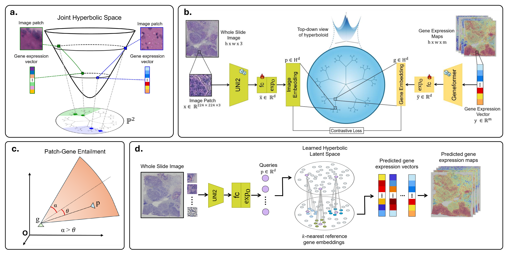

<div align="center">

# Hyperbolic Contrastive Learning with Entailment for Spatial Transcriptomics

**Daniela Vega\*, Paula Cárdenas, Hannah Ceballos, Leonardo Manrique, and Pablo Arbeláez**

Universidad de los Andes, Colombia

</div>

## News

- **2026:** HyCLoST was accepted to **MICCAI 2026**.

## Abstract

Spatial Transcriptomics (ST) has transformed biomedical research by enabling the spatial mapping of gene expression across tissue sections. However, high operational costs, specialized equipment requirements, and sensitivity to experimental noise limit the accessibility and scalability of ST. Recent computer vision approaches aim to overcome these limitations by predicting spatial gene expression directly from histopathology images. While effective, current approaches often suffer from gene expression over-smoothing and overly uniform predictions across tissue regions, suggesting that further progress depends on learning representations that reflect the hierarchical and asymmetric structure of gene regulation and tissue morphology. To address these issues, we propose Hyperbolic Contrastive Learning with Entailment for Spatial Transcriptomics (HyCLoST), a hyperbolic contrastive learning model that captures the intrinsic hierarchical relationships within ST data. By leveraging hyperbolic geometry and a gene-to-image entailment loss, HyCLoST learns structured, biologically grounded representations that improve gene expression prediction accuracy, achieving a 6% reduction in MSE and an 8% increase in PCC across 26 ST datasets, over previous methods. 

## Main Figure



**Figure 1.** (a) HyCLoST learns a joint hierarchical representation of histopathology patches and corresponding gene expression vectors via contrastive learning in hyperbolic space. (b) During training, image patches and paired gene expression vectors are encoded with UNI2-h and Geneformer and projected into a shared hyperbolic space. (c) A patch-gene entailment objective models the asymmetric relationship between modalities. (d) In inference, a patch is encoded and projected into the learned hyperbolic space, and its prediction is obtained by averaging the *k* nearest gene embeddings.

## Getting started

Everything below is run from the root of this repository. All data paths are resolved relative to the repository root, so the folder names and structure described here must be kept as-is.

### 1. Download the SpaRED datasets

Download the datasets from the [SpaRED webpage](https://bcv-uniandes.github.io/spared_webpage/index) (linked from there to a Google Drive folder) and place them in `data/SparedData/` at the root of the repository, with every `.h5ad` file named after its dataset:

```
data/SparedData/
├── 10xgenomic_human_brain.h5ad
├── 10xgenomic_human_breast_cancer.h5ad
├── ...
└── villacampa_mouse_brain.h5ad
```

<details>
<summary>The 26 datasets</summary>

`10xgenomic_human_brain`, `10xgenomic_human_breast_cancer`, `10xgenomic_mouse_brain_coronal`, `10xgenomic_mouse_brain_sagittal_anterior`, `10xgenomic_mouse_brain_sagittal_posterior`, `abalo_human_squamous_cell_carcinoma`, `erickson_human_prostate_cancer_p1`, `erickson_human_prostate_cancer_p2`, `fan_mouse_brain_coronal`, `fan_mouse_olfatory_bulb`, `mirzazadeh_human_colon_p1`, `mirzazadeh_human_colon_p2`, `mirzazadeh_human_pediatric_brain_tumor_p1`, `mirzazadeh_human_pediatric_brain_tumor_p2`, `mirzazadeh_human_prostate_cancer`, `mirzazadeh_human_small_intestine`, `mirzazadeh_mouse_bone`, `mirzazadeh_mouse_brain`, `mirzazadeh_mouse_brain_p1`, `mirzazadeh_mouse_brain_p2`, `parigi_mouse_intestine`, `vicari_human_striatium`, `vicari_mouse_brain`, `villacampa_kidney_organoid`, `villacampa_lung_organoid`, `villacampa_mouse_brain`

</details>

### 2. Download the precomputed embeddings

HyCLoST works on frozen, precomputed features: [UNI2-h](https://huggingface.co/MahmoodLab/UNI2-h) features of the histology patches and [Geneformer](https://huggingface.co/ctheodoris/Geneformer) embeddings of the gene expression vectors. Download them from `<EMBEDDINGS_DRIVE_LINK>` and place them in `embeddings/` at the root of the repository:

```
embeddings/
├── aug_features/                        # UNI2-h patch features
│   └── <dataset>/
│       ├── train/  <x>_<y>.npy          # one file per spot, shape (8, 1536)
│       ├── val/    <x>_<y>.npy
│       └── test/   <x>_<y>.npy          # only for datasets that have a test split
└── embs_geneformer/                     # Geneformer gene expression embeddings
    └── <dataset>/
        ├── train/  encoded_genes.csv    # one row per spot, 768 columns
        ├── val/    encoded_genes.csv
        └── test/   encoded_genes.csv    # only for datasets that have a test split
```

- `<x>_<y>` are the spot's spatial coordinates (`adata.obsm["spatial"]`), e.g. `10038.0_2638.0.npy`.
- Each patch feature file holds 8 vectors, one per symmetry of the patch (the 8 flips/rotations). During training one is sampled at random; at test time `--eight_sym_test` averages the predictions over all 8, otherwise only the original one is used.

### 3. Download the checkpoints

Download the checkpoints from `<CHECKPOINTS_DRIVE_LINK>` and place the `checkpoints/` folder at the root of the repository. Each dataset has one model in `best_run/`:

```
checkpoints/
└── <dataset>/
    └── best_run/
        └── checkpoint_best.pth
```

### Final repository structure

```
HyCLoST/
├── README.md
├── complete_plot_v3.png
├── configs/
│   ├── train_meru_spared.py
│   └── gene_expression_prediction.py
├── meru/                                # model, losses, data, evaluation
├── scripts/
│   ├── train_spared.py                  # training and inference
├── UNI/
├── data/
│   └── SparedData/
│       └── <dataset>.h5ad               # x26
├── embeddings/
│   ├── aug_features/<dataset>/{train,val,test}/<x>_<y>.npy
│   └── embs_geneformer/<dataset>/{train,val,test}/encoded_genes.csv
└── checkpoints/
    └── <dataset>/best_run/checkpoint_best.pth
```

## Inference

Evaluate a pretrained checkpoint on the test split of a dataset. Set `DATASET` to any of the 26 dataset names:

```bash
DATASET=villacampa_kidney_organoid

CUDA_VISIBLE_DEVICES=0 python scripts/train_spared.py \
    --config configs/train_meru_spared.py \
    --num-gpus 1 \
    --output-dir ./outputs_final_geneformer_aug \
    --entail_weight 0.5 \
    --dist-url tcp://127.0.0.1:2162 \
    --dataset ${DATASET} \
    --top_k 80 \
    --num_genes 768 \
    --encode_genes \
    --active_embedding \
    --eight_sym_test \
    --only_test \
    --ckpts_path ./checkpoints/${DATASET}/best_run/checkpoint_best.pth
```

The test MSE and PCC-Gene are printed at the end.

- If the port in `--dist-url` is already in use, pick another one.
- The script logs to [Weights & Biases](https://wandb.ai) (`project=HyCloST`, `entity=spared_v2`. set in the `wandb.init(...)` call of  `scripts/train_spared.py`). To run with [Weights & Biases](https://wandb.ai), replace `entity` with your own username or team, or run with `WANDB_MODE=disabled`.

## Training

Train a model from scratch on a dataset. It is the same command as inference without `--only_test` and `--ckpts_path`:

```bash
DATASET=villacampa_kidney_organoid

CUDA_VISIBLE_DEVICES=0 python scripts/train_spared.py \
    --config configs/train_meru_spared.py \
    --num-gpus 1 \
    --output-dir ./outputs_final_geneformer_aug \
    --entail_weight 0.5 \
    --dist-url tcp://127.0.0.1:2162 \
    --dataset ${DATASET} \
    --top_k 80 \
    --num_genes 768 \
    --encode_genes \
    --active_embedding \
    --eight_sym_test
```

Training hyperparameters are defined in [configs/train_meru_spared.py](configs/train_meru_spared.py). 

### What is saved

Each run creates a folder named after the start time:

```
<output-dir>/<dataset>/<YYYY-MM-DD-HH-MM-SS>/
├── config.yaml                          # full config of the run
├── log-rank0.txt                        # training log
├── events.out.tfevents.*                # TensorBoard logs (losses, learning rate)
├── k_80/
│   ├── checkpoint_best.pth              # best checkpoint
│   └── last_checkpoint.txt              # iteration at which it was saved
└── preds/
    └── eight_sym_test/test.pt           # test predictions (preds/test.pt without --eight_sym_test)
```

- **Checkpoint:** `k_<top_k>/checkpoint_best.pth` is overwritten every time the validation MSE improves, so at the end it holds the model with the lowest validation MSE, not the last one. It is a dictionary with `model`, `optimizer`, `scheduler`, `scaler` (the training states) and `iteration` (when it was saved). The best validation MSE can occur early in training, so check `iteration`.
- **Predictions:** `test.pt` is a dictionary with `prediction` (the predicted expression) and `c_StepB_log1p` (the ground truth), both NumPy arrays of shape `(num_test_spots, num_genes)`.

## Citation

```bibtex
@inproceedings{vega2026hyclost,
  title     = {Hyperbolic Contrastive Learning with Entailment for Spatial Transcriptomics},
  author    = {Vega, Daniela and Cárdenas, Paula and Ceballos, Hannah and Manrique, Leonardo and Arbeláez, Pablo},
  booktitle = {International Conference on Medical Image Computing and Computer-Assisted Intervention},
  year      = {2026}
}
```
